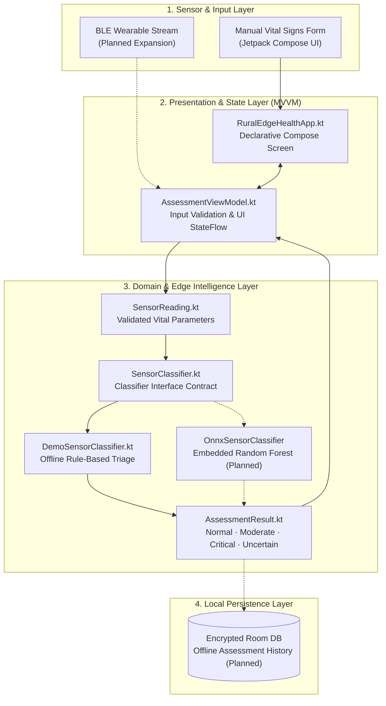

# RuralEdgeHealth


**RuralEdgeHealth** is an offline-first Android application built with **Kotlin** and **Jetpack Compose** that demonstrates how physiological IoT sensor readings can be validated and classified directly on low-cost smartphones without internet connectivity.

> **Disclaimer:** This project is an educational and research prototype demonstrating edge-computing architecture. It is **not** a certified medical device and must not be used for clinical diagnosis or treatment decisions.

---

## 🎯 Use Case & Problem Statement

Community health workers in rural or low-connectivity regions often lack reliable cellular or broadband access needed for cloud-dependent telehealth triage tools.

**RuralEdgeHealth addresses this constraint through an offline edge architecture:**
- **Zero-Connectivity Inference:** Validates five vital physiological indicators (Heart Rate, SpO₂, Body Temperature, Systolic BP, and Diastolic BP) and runs classification entirely on-device—even in Airplane Mode.
- **Pluggable Classifier Contract (`SensorClassifier.kt`):** Decouples the Jetpack Compose MVVM presentation layer from the underlying inference engine so teams can swap seamlessly between deterministic rule-based triage (`DemoSensorClassifier`) and an embedded **ONNX Runtime** Random Forest model (`OnnxSensorClassifier`).
- **Modular Sensor Ingestion:** Normalizes manual form input and planned Bluetooth Low Energy (BLE) wearable streams into a unified immutable domain model (`SensorReading`).

---

## 🏗️ System Architecture



---

## 📁 Project Structure

```text
rural-edge-health/
├── app/
│   ├── build.gradle.kts                                      # Android app module configuration & Compose dependencies
│   └── src/
│       ├── main/java/org/ruraledgehealth/app/
│       │   ├── MainActivity.kt                               # Android activity host
│       │   ├── domain/
│       │   │   ├── classifier/
│       │   │   │   ├── SensorClassifier.kt                   # Pluggable inference interface
│       │   │   │   └── DemoSensorClassifier.kt               # Offline physiological triage classifier
│       │   │   └── model/
│       │   │       ├── SensorReading.kt                      # Immutable vital-signs domain model
│       │   │       └── AssessmentResult.kt                   # Classification output & severity enum
│       │   └── ui/
│       │       ├── RuralEdgeHealthApp.kt                     # Main Jetpack Compose assessment screen
│       │       ├── assessment/AssessmentViewModel.kt         # MVVM state holder & input validator
│       │       └── theme/Theme.kt                            # Material 3 theme definition
│       └── test/java/org/ruraledgehealth/app/domain/classifier/
│           └── DemoSensorClassifierTest.kt                   # JUnit 4 unit tests for triage boundaries
├── docs/
│   ├── README.md                                             # Documentation reading order index
│   ├── PROJECT_OVERVIEW.md                                   # Problem statement & project scope
│   ├── ARCHITECTURE.md                                       # Five-layer edge architecture specification
│   ├── GETTING_STARTED.md                                    # Environment & emulator setup guide
│   ├── IMPLEMENTATION_GUIDE.md                               # Roadmap for ONNX, BLE, and encrypted Room storage
│   └── GLOSSARY.md                                           # Clinical & technical terminology reference
├── build.gradle.kts                                          # Root Gradle build configuration
└── settings.gradle.kts
```

---

## 🚀 Prerequisites & Setup

### Prerequisites
- **JDK:** `17+`
- **Android Studio:** Ladybug / Koala or newer (with Android SDK 34+)
- **Android Device or Emulator:** API Level 26+ (Android 8.0+)

### Installation

```bash
# 1. Clone the repository
git clone https://github.com/gmanojkumar2000/rural-edge-health.git
cd rural-edge-health
```

Open the project root in **Android Studio** and allow Gradle to sync dependencies automatically.

---

## 💻 How to Run & Test

### Run on an Android Emulator or Device
1. Select the `app` run configuration in Android Studio and click **Run (▶)**, *or* install via the Gradle wrapper:
   ```bash
   # Windows PowerShell
   .\gradlew.bat installDebug

   # macOS / Linux
   ./gradlew installDebug
   ```
2. Enter five physiological readings (or load sample values) and tap **Analyze Readings**—works completely offline with Airplane Mode enabled.

### Run Automated Unit Tests
```bash
# Windows PowerShell
.\gradlew.bat testDebugUnitTest

# macOS / Linux
./gradlew testDebugUnitTest
```
